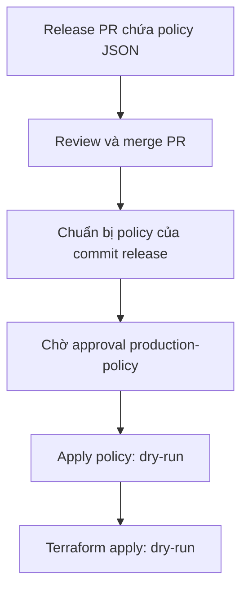

# Production policy approval inside the release pipeline

> Keep the policy change in the release PR, and add one approval step just before the policy is applied to production. Terraform apply may wait for it. The release PR review does not count as this approval.

## Luồng trong PR mẫu

- Giữ `examples/iam/policy.json` cùng code/workflow trong một release PR; không cần PR policy riêng.
- PR validation chỉ parse JSON và xuất artifact/summary, không yêu cầu production approval.
- Sau merge vào main, prepare job công bố commit SHA, nội dung JSON và SHA256 để reviewer xem.
- Job `apply-policy` dùng Environment `production-policy`: GitHub chặn **trước khi job bắt đầu** cho tới khi reviewer chọn **Review deployments → Approve and deploy**.
- PR approval không được đọc hoặc tính thay deployment approval. Người đã review PR vẫn có thể là deployment reviewer nếu chính sách nhóm cho phép; họ phải thực hiện approval riêng trong Actions.
- Policy được lấy từ artifact của chính run, đối chiếu SHA256 trước bước apply; không checkout main mới nhất sau thời gian chờ.
- Job Terraform có `needs: apply-policy`: chờ cả approval và apply policy thành công. Reject/cancel/failure khiến nó không tiếp tục.
- Không có credentials, id-token permission, AWS call hay Terraform apply thật trong workflow mới. Hai bước apply đều mô phỏng.

## Cấu hình bắt buộc để có approval thật

Repository **Settings → Environments → New environment → production-policy**:

1. Bật **Required reviewers**, chọn user/team thực sự có trách nhiệm duyệt production policy.
2. Bật **Prevent self-review** nếu không cho người khởi chạy tự duyệt. Không bật tùy chọn này chỉ để thay cho quy định reviewer; nó không có nghĩa reviewer PR phải là người khác.
3. Tắt bypass protection rules nếu chính sách yêu cầu; giới hạn deployment branch là main.
4. Sau khi kiểm tra cấu hình, tạo environment variable `PRODUCTION_POLICY_APPROVAL_CONFIGURED=true`.
   Đây là xác nhận vận hành, **không tự tạo hoặc kiểm chứng reviewer settings**. Xóa protection sau đó vẫn có thể bỏ gate; bảo vệ quyền quản trị environment.

Chỉ khai báo `environment:` trong YAML **không đủ**: GitHub có thể tạo environment chưa có protection và job không chờ.
Biến xác nhận mặc định chưa có khiến ví dụ dừng trước bước apply preview. PR này chưa sửa repository settings hay tự gán reviewer.

## Cách xem kết quả

1. Trong draft PR, xem Files changed: chỉ policy mẫu, workflow và tài liệu này.
2. Sau khi cấu hình environment và sẵn sàng cài đặt, merge PR. Push trên main chạy prepare rồi hiển thị Waiting / Review deployments.
3. Mở prepare job summary để đọc JSON đúng SHA, rồi approve environment.
4. Xem apply-policy kiểm tra hash và in lệnh put-role-policy; job Terraform dry-run mới được chạy tiếp.
5. Dùng lần chạy khác để thử reject: không có bước apply/tiếp tục release nào được chạy.

Chưa chạy end-to-end production approval: cần workflow trên main và reviewer settings thật.
Không cần merge chỉ để đọc mẫu. Merge lên main hiện cũng kích hoạt CI/CD deploy Java/Terraform **sẵn có** của repo.

## Tích hợp production thật

Workflow này là ví dụ độc lập, **chưa chặn job deploy của `.github/workflows/ci-cd.yml` hiện có** (repo hiện dùng TF_ENV=dev).
Khi áp dụng cho release production, đưa các job prepare/apply-policy vào chính pipeline release và nối Terraform apply với `needs: apply-policy`.
Không dùng hai workflow chạy song song rồi giả định `needs` chặn được workflow khác.

- Nếu dùng `put-role-policy`: chỉ assume OIDC role hẹp trong job có environment sau approval; thay placeholder bằng role/policy production đã xác nhận.
- Nếu Terraform quản lý policy: không thêm `put-role-policy` ngoài Terraform. Tạo và công bố saved plan trước gate; đặt environment trực tiếp trên job Terraform apply rồi apply đúng saved plan đã được duyệt. Cả Terraform apply có thể chờ approval này.
- Với plan chứa dữ liệu nhạy cảm, giới hạn quyền và thời gian lưu artifact. Kiểm soát drift và thời hạn plan trong quy trình release.
- Serialize production releases, bảo vệ workflow/environment và yêu cầu PR review cho thay đổi pipeline. Concurrency mẫu không bảo đảm FIFO; release thật cần quy định không deploy release cũ sau release mới.
- Chỉ validate cú pháp JSON ở mẫu này, chưa kiểm chứng IAM semantics hay least privilege.
- Mỗi deployment job/run mới yêu cầu approval riêng theo environment rules; PR review không mở khóa nó.

Tài liệu GitHub: https://docs.github.com/en/actions/how-tos/deploy/configure-and-manage-deployments/review-deployments
và https://docs.github.com/en/actions/how-tos/deploy/configure-and-manage-deployments/manage-environments
