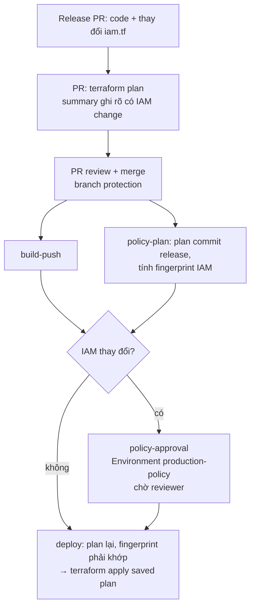

# Production policy approval trong pipeline release

> Keep the policy change in the release PR, and add one approval step just before the policy is applied to production. Terraform apply may wait for it. The release PR review does not count as this approval.

## Luồng

Policy IAM do Terraform quản lý (`infra/app/iam.tf`) và nằm chung release PR với code. Không có PR policy riêng
và không gọi `put-role-policy` ngoài Terraform.



| Job (`ci-cd.yml`) | Việc làm |
| --- | --- |
| `terraform-plan` (PR) | Summary có mục **IAM policy changes**, cho reviewer PR biết release sẽ dừng chờ approval sau merge |
| `policy-plan` (main) | Plan commit release, liệt kê thay đổi `aws_iam_*` và tính fingerprint SHA256 (`.github/scripts/iam-plan-changes.sh`) |
| `policy-approval` | Chỉ chạy khi có IAM change. Dùng Environment `production-policy`, nên GitHub giữ job ở trạng thái *Waiting* cho tới khi reviewer duyệt. Sau đó job đọc API approvals: không có approval thật thì fail |
| `deploy` | Plan lại có lock. Nếu plan có IAM change thì bắt buộc `policy-approval` = success **và** fingerprint khớp với bản đã duyệt. Sau đó apply đúng saved plan đó |

PR review **không** mở khoá được job `policy-approval`, vì đây là approval trên Environment chứ không phải trên PR.
Summary của `policy-approval` ghi riêng hai dòng: ai approve PR (không tính) và ai approve `production-policy`.

Release không đổi IAM thì không có bước chờ: `policy-approval` bị skip và `deploy` chạy như trước.

### Vì sao tách job approval khỏi job deploy

Khi job khai báo `environment:`, OIDC subject đổi từ `repo:<repo>:ref:refs/heads/main` thành
`repo:<repo>:environment:production-policy`, và trust policy của deploy role hiện tại không chấp nhận subject này.
Vì vậy job approval không lấy AWS credentials, còn `deploy` giữ nguyên subject cũ. Fingerprint giúp bảo đảm thứ
được apply đúng là thứ đã được duyệt. Nếu IAM change mới xuất hiện sau khi duyệt (drift, hoặc state đổi), `deploy`
sẽ fail thay vì apply.

## Cấu hình GitHub (bắt buộc, YAML không tự tạo được)

Điều kiện: repo **public**, hoặc private trên GitHub Enterprise. Required reviewers cho environment không dùng được
với repo private ở gói Free/Pro. Branch protection cho repo private cần ít nhất gói Pro.

PR author không thể tự approve PR của mình, nên cần thêm **tài khoản thứ hai** có quyền write để review PR.

```bash
REPO=trminhkhoi76-code/auth-service
SECOND=<login-tài-khoản-review-PR>        # ví dụ mktran76
gh api -X PUT repos/$REPO/collaborators/$SECOND -f permission=push   # tài khoản đó phải accept lời mời

# 1) main: bắt buộc PR + 1 approval + CI xanh, admin cũng không bypass được
gh api -X PUT repos/$REPO/branches/main/protection --input - <<'EOF'
{
  "required_status_checks": {
    "strict": true,
    "contexts": ["Test", "Terraform fmt & validate", "Terraform plan (main)"]
  },
  "enforce_admins": true,
  "required_pull_request_reviews": {
    "required_approving_review_count": 1,
    "dismiss_stale_reviews": true,
    "require_last_push_approval": true
  },
  "restrictions": null
}
EOF

# 2) production-policy: reviewer bắt buộc, chỉ deploy từ branch được bảo vệ, admin không bypass được
REVIEWER_ID=$(gh api users/trminhkhoi76-code --jq .id)
gh api -X PUT repos/$REPO/environments/production-policy --input - <<EOF
{
  "reviewers": [{"type": "User", "id": $REVIEWER_ID}],
  "prevent_self_review": false,
  "can_admins_bypass": false,
  "deployment_branch_policy": {"protected_branches": true, "custom_branch_policies": false}
}
EOF

# Kiểm tra lại
gh api repos/$REPO/environments/production-policy --jq '.protection_rules'
gh api repos/$REPO/branches/main/protection --jq '{reviews: .required_pull_request_reviews.required_approving_review_count, admins: .enforce_admins.enabled}'
```

`prevent_self_review: false` là cần thiết khi chỉ có một người duyệt environment, vì người merge cũng là người kích hoạt
run. Nếu nhóm có từ hai người duyệt trở lên thì nên bật `true`.

## Chạy thử end-to-end và thu bằng chứng

Release PR mẫu đổi `infra/app/iam.tf`: thêm `sid = "ReadAppSecrets"` vào policy `read-app-secrets` của execution role.
Policy JSON thay đổi (update in-place) nên kích hoạt gate, nhưng **quyền giữ nguyên**.

> Merge vào `main` sẽ chạy `terraform apply` thật trên môi trường `dev` (`TF_ENV=dev`), nghĩa là môi trường mà `main`
> deploy tới.

### 1. Trước khi PR được review: merge bị chặn

```bash
gh pr ready 3 --repo $REPO
gh pr view 3 --repo $REPO --json reviewDecision,mergeStateStatus
#   kỳ vọng: "reviewDecision": "REVIEW_REQUIRED", "mergeStateStatus": "BLOCKED"
gh pr merge 3 --repo $REPO --merge
#   kỳ vọng lỗi: the base branch policy prohibits the merge
gh pr merge 3 --repo $REPO --merge --admin
#   vẫn lỗi, vì enforce_admins=true
```

Mở job summary của `Terraform plan (main)` trong PR. Mục **IAM policy changes** ghi 1 resource và hiển thị diff `Sid`.

### 2. Review PR bằng tài khoản thứ hai, rồi merge

```bash
gh pr review 3 --repo $REPO --approve                   # chạy bằng tài khoản $SECOND
gh pr view 3 --repo $REPO --json reviewDecision,mergeStateStatus   # APPROVED / CLEAN
gh pr merge 3 --repo $REPO --merge                      # tài khoản owner
```

### 3. Sau merge: PR đã approve nhưng apply vẫn bị chặn

```bash
RUN=$(gh run list --repo $REPO --workflow ci-cd.yml --branch main --event push --limit 1 --json databaseId --jq '.[0].databaseId')
gh run view $RUN --repo $REPO --json status,jobs --jq '{status, jobs: [.jobs[] | {name, status, conclusion}]}'
#   kỳ vọng: status "waiting"; "Approve IAM policy for production" waiting; "Deploy (terraform apply)" chưa chạy
gh api repos/$REPO/actions/runs/$RUN/pending_deployments \
  --jq '.[] | {environment: .environment.name, reviewers: [.reviewers[].reviewer.login]}'
aws iam get-role-policy --role-name auth-service-ecs-execution-dev --policy-name read-app-secrets \
  --query 'PolicyDocument.Statement[0].Sid'
#   kỳ vọng: null, tức policy trên AWS chưa đổi
```

### 4. Thử reject: không có gì được apply

```bash
ENV_ID=$(gh api repos/$REPO/environments/production-policy --jq .id)
gh api -X POST repos/$REPO/actions/runs/$RUN/pending_deployments \
  -F "environment_ids[]=$ENV_ID" -f state=rejected -f comment="Reject test"
gh run view $RUN --repo $REPO --json jobs --jq '.jobs[] | {name, conclusion}'
#   kỳ vọng: approval "failure", deploy "skipped"; get-role-policy ở bước 3 vẫn trả về null
```

### 5. Chạy lại rồi approve: policy được apply

```bash
gh run rerun $RUN --repo $REPO           # run lại cần approval mới, không dùng lại kết quả cũ
# chờ tới khi status = waiting, rồi:
gh api -X POST repos/$REPO/actions/runs/$RUN/pending_deployments \
  -F "environment_ids[]=$ENV_ID" -f state=approved -f comment="IAM policy reviewed"
gh run watch $RUN --repo $REPO
gh api repos/$REPO/actions/runs/$RUN/approvals --jq '.[] | {state, user: .user.login, comment}'
aws iam get-role-policy --role-name auth-service-ecs-execution-dev --policy-name read-app-secrets \
  --query 'PolicyDocument.Statement[0].Sid'
#   kỳ vọng: "ReadAppSecrets"
```

Có thể duyệt bằng UI thay cho API: mở run, chọn **Review deployments → production-policy → Approve and deploy**.
Summary của job `policy-approval` có bảng ghi người approve PR (không tính) và người approve `production-policy`.
Log của `deploy` có dòng `IAM changes … match the production-policy approval.`

## Giới hạn

- Gate dựa trên resource `aws_iam_*` trong plan của `infra/app`. Bucket policy, KMS key policy và các resource khác không bị gate.
- `infra/bootstrap` (role GitHub Actions) vẫn apply bằng tay, bằng quyền admin, nên không đi qua gate này.
- Ai có quyền admin repo vẫn có thể sửa environment hoặc xoá protection. Job `policy-approval` fail nếu không có
  approval thật, nhưng không ngăn được việc sửa chính workflow. Workflow là file trong repo, nên thay đổi workflow
  cũng phải đi qua PR review do branch protection.
- Approval có thời hạn chờ tối đa 30 ngày theo GitHub. Push mới vào `main` trong lúc chờ sẽ xếp hàng sau run đang chờ.

Tài liệu GitHub: [Reviewing deployments](https://docs.github.com/en/actions/how-tos/deploy/configure-and-manage-deployments/review-deployments),
[Managing environments](https://docs.github.com/en/actions/how-tos/deploy/configure-and-manage-deployments/manage-environments).
